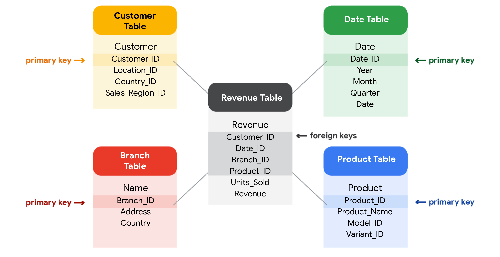

# Trabajar con bases de datos

## Todo sobre bases de datos
- Hola de nuevo.
- ​Hasta ahora, ha visto cómo se pueden recopilar y ​analizar datos para resolver todo tipo de problemas.
- ​En el siguiente paso, aprenderemos todo sobre las bases de datos.
- Como recordatorio, una ​base de datos es una colección de datos almacenados en un sistema de computadora, pero el ​almacenamiento es solo el comienzo.
- ​Descubrirá cómo las bases de datos permiten ​encontrar la información exacta que necesita para su análisis.
- ​También aprenderá a ordenar los datos para ampliar lo que necesita para ​generar informes detallados y mucho más.
- ​Luego profundizaremos aún más, y quiero decir muy, muy profundo.

- ​Me refiero a los metadatos.
- ​Probablemente hayas escuchado a alguien decir: «Vaya, eso es tan genial».
- ​Por lo general, hablan de algo que hace referencia a sí mismo o de que ​son completamente conscientes de sí mismos.
- ​Por ejemplo, si un personaje de un libro sabe que está en un libro, eso es meta.
- ​Si haces un documental sobre cómo hacer documentales, eso también es meta.
- Y ​aquí en Google, analizo constantemente cómo analizo los datos.
- ​Eso es definitivamente meta.

- ​Lo hago para comprobar la calidad de mi trabajo y asegurarme de que mis métodos son justos.
- ​Y para asegurarme de que estoy prestando atención a cualquier sesgo que pueda ​afectar el resultado.
- ​Como analista, tú también deberías hacer esto.
- ​A veces nos acercamos demasiado a nuestros datos.
- ​Por lo tanto, dar un paso atrás y preguntarnos si nuestros procesos tienen sentido es clave.
- ​Pero hagamos un poco de respaldo y definamos los metadatos.
- ​Los metadatos son datos sobre datos.

- ​Como dije: profundo.
- ​Los metadatos son extremadamente importantes cuando se trabaja con bases de datos.
- ​Piense en ello como una guía de referencia.
- ​Sin la guía, ​todo lo que tiene es un montón de datos sin contexto que explique lo que significa.
- ​Los metadatos indican de dónde provienen los datos, cuándo y cómo se crearon y ​de qué se tratan.
- ​A continuación, aprenderás cómo tomar datos de una base de datos u otra fuente y ​llevarlos a una hoja de cálculo.
- ​Para ello, puede importarlo directamente o ​utilizar SQL para generar la solicitud.

- ​Y una vez que tienes los datos en una hoja de cálculo, las posibilidades son infinitas.
- ​Todo lo que vamos a cubrir es una parte muy importante de la fase de preparación ​del proceso de análisis de datos.
- ​Es la forma en que los analistas de datos determinan qué tipo de datos ​les serán más útiles.
- ​Si tiene los datos correctos, es ​mucho más probable que pueda resolver sus problemas empresariales con éxito.
- ​Entonces, ¿estás listo para aprovechar el increíble poder de las bases de datos? ​¡Vamos! 

---

## Características y componentes de la base de datos
- Las bases de datos son herramientas esenciales para los analistas de datos.
- Los uso constantemente.
- ​Casi todos los datos a los que accedo se almacenan en bases de datos.
- ​Las bases de datos almacenan y organizan los datos, lo que facilita mucho a ​los analistas de datos la administración y el acceso a la información.
- ​Nos ayudan a obtener información más rápido, a tomar decisiones basadas en datos y a resolver problemas.
- ​Ya ha escuchado un poco sobre qué son las bases de datos y ​cómo las utilizan los analistas de datos.
- ​Ahora aprendamos más sobre las características y los componentes de las bases de datos.

- ​Esta es una estructura de base de datos sencilla.
- ​Contiene tablas con información de un fabricante de automóviles.
- ​El nivel superior incluye concesionarios de automóviles, detalles del producto y piezas de reparación.
- ​Luego, si profundizas en el siguiente nivel seleccionando una de esas tablas, ​encontrarás detalles más específicos sobre cada elemento.
- ​Esto se denomina base de datos relacional.
- ​Una base de datos relacional es una base de datos que contiene una serie de tablas relacionadas ​que se pueden conectar a través de sus relaciones.
- ​Para que dos tablas tengan una relación, ​deben existir uno o más campos iguales en ambas tablas.

- ​Por ejemplo, aquí, el ID de sucursal existe en esta tabla y en esta.
- ​Si existe un campo en ambas tablas, podemos usarlo para conectar las tablas.
- ​El campo ID de sucursal es la clave para conectar estas tablas.
- ​Hay dos tipos de llaves.
- ​Una clave principal es un identificador que hace referencia a una columna en la que cada valor ​es único.
- Puede considerarlo como un identificador único para cada fila de una tabla.
- ​Para nuestra tabla de concesionarios con información sobre las diferentes sucursales de concesionarios, la ​clave principal es el identificador de sucursal.

- ​Del mismo modo, para la tabla de detalles del producto de cada automóvil, el VIN es nuestra clave principal.
- ​Como analista, es posible que necesite crear tablas.
- ​Si decides incluir una clave principal, debe ser única, lo que ​significa que no hay dos filas que puedan tener la misma clave principal.
- ​Además, no puede ser nulo ni estar en blanco.
- ​También hay claves foráneas.
- ​Una clave externa es un campo de una tabla que es una clave principal de otra tabla.
- ​En otras palabras, una clave externa es la forma en que una tabla se puede conectar a otra.

- ​Como nuestra tabla de piezas de reparación contiene información sobre cada pieza del automóvil, ​la clave principal es la identificación de la pieza.
- ​Cada fila de nuestra tabla de piezas de reparación representa una pieza única.
- ​Todas las demás claves de esta tabla, como el VIN, son las claves externas que permiten ​conectar la tabla de piezas de reparación a las demás tablas.
- ​Como puede ver, una tabla solo puede tener una clave principal, ​pero puede tener varias claves externas.
- ​Entender las claves principales y foráneas puede ser complicado, por lo ​que tendrás más oportunidades de practicar próximamente.
- ​Sin embargo, como resumen general, ​se usa una clave principal para garantizar que los datos de una columna específica sean únicos.
- ​Identifica de forma exclusiva un registro en una tabla de base de datos relacional.

- ​Solo se permite una clave principal en una tabla y ​no pueden contener valores nulos o en blanco.
- ​Y una clave externa es una columna o grupo de columnas de una tabla de base de datos relacional ​que proporciona un enlace entre los datos y dos tablas.
- ​Hace referencia al campo de una tabla que es la clave principal de otra tabla.
- ​Por último, es importante tener en cuenta que se permite que haya más de una clave ​externa en una tabla.
- ​No dudes en volver a ver este vídeo para asegurarte de que entiendes con ​claridad las claves principales y foráneas.
- ​Y próximamente, empezará a practicar cómo acceder y ​analizar datos de bases de datos reales.
- ​Será una gran oportunidad para mejorar su comprensión de ​las claves principales y externas, la organización de las bases de datos y la ​forma en que podría utilizar las bases de datos en su futura carrera de análisis.

---

## Maximizar las bases de datos en la Analítica de datos
- Las Bases de datos permiten a los analistas manipular, almacenar y procesar datos.
- Esto les ayuda a buscar entre los Datos de forma mucho más eficaz para obtener las mejores estadísticas.

- Bases de datos relacionales
   - Una base de datos relacional es una base de datos que contiene una serie de tablas que pueden conectarse para formar relaciones.
   - Básicamente, permiten a los analistas de datos organizar y vincular datos basándose en lo que los datos tienen en común. 
   - En una tabla no relacional, encontrará agrupadas todas las posibles variables que le interese analizar.
   - Esto puede dificultar mucho la clasificación.
   - Ésta es una de las razones por las que las bases de datos relacionales son tan comunes en el análisis de datos: simplifican muchos procesos de análisis y facilitan la búsqueda y el uso de los datos en toda una base de datos.
   - La normalización es un proceso de organización de los datos en una base de datos relacional.
   - Por ejemplo, creando tablas y estableciendo relaciones entre esas tablas.
   - Se aplica para eliminar la redundancia de los datos, aumentar su integridad y reducir su complejidad en una base de datos.

- La clave de las bases de datos relacionales
   - Las tablas de una base de datos relacional están conectadas por los campos que tienen en común.
   - Puede que recuerde haber aprendido antes sobre claves primarias y foráneas.
   - Como repaso rápido, una clave primaria es un identificador que hace referencia a una columna en la que cada valor es único.
   - En otras palabras, es una columna de una tabla que se utiliza para identificar de forma única cada registro dentro de esa tabla.
   - El valor asignado a la clave primaria en una fila concreta debe ser único dentro de toda la tabla.
   - Por ejemplo, si customer_id es la clave primaria de la tabla de clientes, nunca habrá dos clientes que tengan el mismo customer_id.
   - Por el contrario, una clave foránea es un campo dentro de una tabla que es una clave primaria en otra tabla.
   - Una tabla sólo puede tener una clave primaria, pero puede tener varias claves foráneas.
   - Estas claves son las que crean las relaciones entre las tablas de una base de datos relacional, lo que ayuda a organizar y conectar los datos de varias tablas de la base de datos. 
   - Algunas tablas no requieren una clave primaria.
   - Por ejemplo, una tabla de Ingresos puede tener múltiples claves foráneas y no tener una clave primaria.
   - Una clave primaria también puede construirse utilizando varias columnas de una tabla.
   - Este tipo de clave primaria se denomina clave compuesta.
   - Por ejemplo, si customer_id y location_id son dos columnas de una clave compuesta para una tabla de clientes, los valores asignados a esos campos en cualquier fila deben ser únicos dentro de toda la tabla.
   

- ¿SQL? Está hablando mi idioma
   - Como ha estado aprendiendo, el Lenguaje de Consulta Estructurada (SQL) es un tipo de lenguaje de consulta que permite a los analistas de datos comunicarse con una base de datos.
   - Así, un analista de datos utilizará SQL para crear una consulta que le permita ver los datos específicos que desea dentro de un conjunto de datos más amplio.
   - En una base de datos relacional, los analistas de datos pueden escribir consultas para obtener datos de las tablas relacionadas.
   - SQL es una poderosa herramienta para trabajar con bases de datos, ¡por eso va a aprender más sobre ella a continuación!

---

## Inspección de un Conjunto de datos: Una visita guiada y práctica
- Como Analista de datos, utilizará los datos para responder a preguntas y resolver problemas.
- Cuando analiza Datos y extrae conclusiones, está generando estadísticas que pueden influir en las decisiones empresariales, impulsar cambios positivos y ayudar a las partes interesadas a alcanzar sus objetivos.
- Antes de comenzar un análisis, es importante inspeccionar sus datos para determinar si contienen la información específica que necesita para responder a las preguntas de sus partes interesadas.
- En cualquier Conjunto de datos dado, puede darse el caso de que:
   - Los datos no existen (tiene datos sobre sándwiches, pero necesita datos sobre pizzas)
   - Los datos sean insuficientes (tiene datos de pizza del 1 al 7 de junio, pero necesita datos de todo el mes de junio)
   - Los datos son incorrectos (sus datos de pizza indican que el coste de una porción es de 250 $, lo que le hace cuestionar la validez del conjunto de datos)
- La Inspección de su Conjunto de datos le ayudará a determinar qué preguntas tienen respuesta y qué datos siguen faltando.
- Es posible que pueda recuperar estos datos de una fuente externa o, al menos, recomendar a sus partes interesadas que utilicen otra fuente de datos.
- En esta lectura, imagine que es usted un Analista de datos que inspecciona los datos de una hoja de cálculo para determinar si es posible responder a las preguntas de sus partes interesadas. 

- El escenario
   - Usted es un analista de datos que trabaja para una empresa de helados.
   - La dirección está interesada en mejorar las ventas de helados de la empresa.
   - La empresa ha estado recopilando datos sobre sus ventas, pero no muchos.
   - Los datos disponibles proceden de una fuente de datos interna y se basan en las ventas de 2019.
   - Se le ha pedido que revise los datos y proporcione algunas estadísticas sobre las ventas de helados de la empresa.
   - Idealmente, a la dirección le gustaría obtener respuestas a las siguientes preguntas:
      - ¿Cuál es el sabor de helado más popular?
      - ¿Cómo afecta la temperatura a las ventas?
      - ¿Cómo afectan a las ventas los fines de semana y los días festivos?
      - ¿En qué se diferencia la rentabilidad de los clientes nuevos de la de los que vuelven?

- Descargar los datos
   - [SalesByTemp.xlsx](./resources/modulo-03/SalesByTemp.xlsx)
   - [SalesByDay.xlsx](./resources/modulo-03/SalesByDay.xlsx)
   - [SalesByFlavor.xlsx](./resources/modulo-03/SalesByFlavor.xlsx)

- Inspección de los Datos
   - Pregunta 1: ¿Cuál es el sabor de helado más popular?
      - Para descubrir cuál es el sabor más popular, primero tiene que definir qué se entiende por "popular"
      - ¿Es el sabor más popular el que generó más Ingresos en 2019?
      - ¿O es el sabor que tuvo el mayor número de unidades vendidas en 2019?
      - A veces sus opciones de medición se ven limitadas por los datos de que dispone; puede revisar su hoja de cálculo para averiguar si alguna de estas definiciones de "popular" tiene sentido en función de los datos disponibles.
      - Clic en la pestaña sabores de su hoja de cálculo para ver los datos relevantes.
      - La hoja de sabores tiene tres columnas y 209 filas de datos.
      - Los encabezados de las columnas son semana, unidades vendidas y sabor.
      - Este Conjunto de datos no venía con una descripción de los datos, por lo que tiene que averiguar el significado de las columnas por su cuenta.
      - Basándose en los datos, usted deduce que estas columnas proporcionan información sobre el número de unidades vendidas de cada sabor de helado, por semana, en 2019
      - En este caso, puede descubrir cuál es el sabor más popular utilizando las unidades vendidas como medida.
      - En concreto, puede utilizar la columna de unidades vendidas para calcular el número total de unidades vendidas durante el año para cada sabor.
      - Lamentablemente, el Conjunto de datos no proporciona el importe de las ventas anuales por sabor.
      - En este caso, su siguiente paso sería preguntar a sus partes interesadas si los datos de ventas anuales por sabor están disponibles en otra fuente.
      - Si no es así, puede añadir a su análisis una declaración sobre las limitaciones de los datos actuales.
   - Pregunta 2: ¿Cómo afecta la temperatura a las ventas?
      - Para explorar su segunda pregunta, haga clic en la ficha de temperaturas y consulte los datos.
      - La hoja de temperaturas tiene dos columnas y 366 filas de datos.
      - Los encabezados de las columnas son temperatura y ventas.
      - Los datos pueden mostrar las ventas totales de 2019 por temperatura (por ejemplo, la primera entrada podría sumar 39,69 $ en ventas durante tres días distintos que tuvieron cada uno una máxima de 60 grados).
      - O bien, los datos pueden mostrar una instantánea de las ventas y la temperatura de cada día de 2019 (por ejemplo, la primera entrada podría referirse a un único día con una máxima de 60 grados y 39,69 dólares en ventas).
      - Entonces, ¿de qué se trata?
      - Probablemente sea una instantánea diaria porque hay 365 entradas para la temperatura, y varias filas con la misma temperatura y diferentes valores de ventas.
      - Esto implica que cada entrada corresponde a un solo día y no a un resumen de varios días.
      - Sin embargo, sin más información, no puede estar seguro.
      - Además, no sabe si los datos actuales aparecen en orden consecutivo por fecha o en un orden diferente.
      - Su siguiente paso sería ponerse en contacto con el propietario del Conjunto de datos para que se lo aclare.
      - Si resulta que la temperatura sí afecta a las ventas, podrá ofrecer a sus partes interesadas una estadística como la siguiente: "Cuando las máximas diarias superan los X grados, las ventas medias de helado aumentan en Y cantidad.
      - Así que la empresa debería planificar el aumento del inventario durante estas épocas para maximizar las ventas"

   - Pregunta 3: ¿Cómo afectan los fines de semana y los días festivos a las ventas?
      - A continuación, haga clic en la ficha de ventas para ver los datos sobre las fechas de venta.
      - La hoja de ventas tiene dos columnas y 366 filas de datos.
      - Los encabezados de las columnas son fecha y ventas.
      - Lo más probable es que estos datos sean las ventas diarias totales en 2019, ASÍ como las ventas registradas para cada fecha en 2019. 
      - Puede utilizar estos datos para determinar si una fecha concreta cae en fin de semana o festivo y añadir una columna a su hoja que refleje esta información.
      - A continuación, podrá averiguar si las ventas de los fines de semana y días festivos son mayores que las de los demás días.
      - Le resultará útil saberlo a efectos de planificación de inventarios y de marketing.
   
   - Pregunta 4: ¿En qué se diferencia la rentabilidad de los nuevos clientes de la de los clientes habituales?
      - Su Conjunto de datos no contiene datos de ventas relacionados con los nuevos clientes.
      - Sin estos datos, no podrá responder a su pregunta final.
      - Sin embargo, puede darse el caso de que la empresa recoja los datos de los clientes y los almacene en una tabla de datos diferente.
      - Si es así, su siguiente paso sería averiguar cómo acceder a los datos de los clientes de la empresa.
      - A continuación, puede unir los datos de ventas de ingresos a la tabla de datos de clientes para categorizar cada venta como de un cliente nuevo o recurrente y analizar la diferencia de rentabilidad entre los dos conjuntos de clientes.
      - Esta información ayudará a las partes interesadas a desarrollar campañas de marketing para tipos específicos de clientes con el fin de aumentar la fidelidad a la marca y la rentabilidad general.

- Puntos clave
   - Cuando trabaje en proyectos de análisis, no siempre dispondrá de todos los datos necesarios o relevantes.
   - En muchos de estos casos, puede recurrir a otras fuentes de datos para cubrir las lagunas.
   - A pesar de las limitaciones de su conjunto de datos, aún es posible ofrecer a sus partes interesadas algunas estadísticas valiosas.
   - Para los siguientes pasos, su mejor plan de acción será tomar la iniciativa de hacer preguntas, identificar otros conjuntos de datos relevantes o hacer alguna investigación por su cuenta.
   - Independientemente de los datos con los que esté trabajando, inspeccionar cuidadosamente sus datos tiene un gran impacto en la calidad general de su análisis.

---

## Ponga a prueba sus conocimientos sobre el trabajo con bases de datos

1. Rellene el espacio en blanco: Una Base de datos relacional contiene una serie de _____ que pueden conectarse para formar relaciones.
   - [ ] campos
   - [x] tablas
   - [ ] hojas de cálculo
   - [ ] células
> 

2. ¿Cómo se denomina un identificador que hace referencia a una columna de la base de datos en la que cada valor es único?
   - [ ] Clave foránea
   - [ ] Relación
   - [x] Clave primaria
   - [ ] Campo
>

3. ¿Qué proceso utilizan los profesionales de los datos para eliminar la redundancia de los datos, aumentar su integridad y reducir su complejidad en una base de datos?
   - [x] Normalización
   - [ ] Composición
   - [ ] Manipulación
   - [ ] Iteración
> 

4. Rellene el espacio en blanco: Cuando se utiliza una base de datos relacional, los analistas de datos escriben _____ para solicitar datos de las tablas relacionadas. 
   - [ ] consultas
   - [ ] relaciones
   - [ ] claves
   - [ ] programas
> 