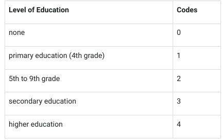

# Ordenación y filtrado de datos

## Ordenación y filtrado para centrarse en los datos relevantes
- ​En los últimos vídeos, ​has aprendido sobre los datos internos y externos.
- ​Ahora te mostraré cómo concentrarte solo en los datos ​que son relevantes para el problema que estás intentando resolver.
- ​Esto es útil si trabajas con ​una hoja de cálculo muy grande y compleja, con la ​que los analistas de datos se encuentran todo el tiempo.
- ​Tener muchos datos puede dificultar la ​búsqueda y el análisis rápidos de la información que necesita.
- ​No hay dos proyectos de análisis iguales.
- ​A menudo, los analistas de datos procesan, ven ​y utilizan los datos de manera muy diferente, ​incluso si provienen exactamente de la misma fuente.
- ​He aquí un ejemplo.
- Consulta esta hoja de cálculo ​que muestra a los representantes de ventas de una empresa y dónde trabajan.

- ​Es posible que distintos analistas de datos deseen ​obtener información diferente de la hoja de cálculo, ​y ahí es donde entran en juego la clasificación y el filtrado.
- ​Ordenar y filtrar los datos de una hoja de cálculo ​nos ayuda a personalizar la forma en que se presentan los datos.
- ​También pueden organizar los datos para que ​los analistas puedan centrarse en las piezas importantes.
- ​Piense en ello como una lupa para nuestros datos.
- ​Empecemos por la clasificación.
- ​La clasificación implica organizar los datos ​en un orden significativo para ​que sean más fáciles de entender, analizar y visualizar.
- ​Datos se pueden ordenar en orden ascendente o descendente, ​y alfabéticamente o numéricamente.

- ​La clasificación se puede realizar en toda ​una hoja de cálculo o solo en una sola columna o tabla.
- ​También puede ordenar por varias variables.
- ​Por ejemplo, si nuestro conjunto de datos ​contiene campos de ciudad y estado, ​podemos ordenar primero por ciudad y luego por estado.
- ​Siempre que ordene datos, ​siempre es una buena idea congelar primero la fila del encabezado.
- ​Para ello, resaltaremos la fila.
- ​A continuación, en el menú de visualización, ​selecciona congelar y una fila.
- ​Esto bloquea la fila en su lugar.

- ​Ahora, cuando nos desplazamos hacia abajo en ​la hoja, la fila del encabezado permanece visible para que sepamos ​la categoría de cada columna.
- ​Me parece que está bien.
- Ahora vamos a ordenar toda la hoja de cálculo.
- ​Primero ordenaremos por ciudad.
- ​Para ello, seleccione la columna de la ciudad y, a ​continuación, utilice la flecha desplegable para ordenar la hoja.
- ​Seleccionar de la A a la Z.
- De ​este modo, se ordenarán todas las columnas de la A a la Z por fila, ​siendo la columna seleccionada el criterio de clasificación principal.

- ​Las ciudades ahora están ordenadas alfabéticamente ​y siguen agrupadas con los estados ​, representantes de ventas y autopartes correspondientes.
- ​Los detalles de cada fila se ​mantienen juntos automáticamente al ordenar una sección en particular, ​como puedes ver aquí.
- ​La clasificación por criterios múltiples es ​otra herramienta de análisis de datos muy útil.
- ​Por ejemplo, supongamos que queremos ver una lista de ​representantes de ventas por ciudades y estados en los que trabajan.
- ​Primero, seleccionamos todo el conjunto de datos, ​luego elegimos los datos y ordenamos el rango.
- La opción de menú ha cambiado ligeramente. Seleccione Datos y Rango de ordenación y, a continuación, elija Opciones avanzadas de ordenación de rangos para ver el cuadro de diálogo que se muestra.
- ​En el cuadro de diálogo, ​asegúrese de que esté resaltado «Datos con fila de encabezado».
- ​De esa forma, la fila A, la ciudad ​, los estados, el representante de ventas y ​las autopartes no formarán parte de eso.

- ​Luego, en el menú desplegable Ordenar por, ​selecciona el estado y el orden de clasificación de la A a la Z.
- ​Ahora agrega otra columna de clasificación.
- ​En el menú desplegable «luego por», selecciona ​la ciudad y el orden de clasificación de la A a la Z.
- ​Por último, selecciona Ordenar.
- ​Ahora podemos buscar en los datos para encontrar fácilmente ​un representante de ventas que trabaje en un estado y una ciudad en particular.
- ​La clasificación es útil cuando quieres ver todo lo que hay en ​una hoja de cálculo en orden alfabético o numérico.
- ​Sin embargo, a veces los analistas de datos quieren ​aislar una información en particular.

- ​Para ello, utilizan un filtro.
- ​Filtrado significa mostrar solo los datos que ​cumplen un criterio específico y ocultar el resto.
- ​Un filtro simplifica una hoja de cálculo al ​mostrarnos solo la información que necesitamos.
- ​Por ejemplo, podríamos agregar un filtro para ver ​solo los representantes de ventas que trabajaron con un producto en particular.
- ​Para ello, primero seleccionamos Datos y creamos un filtro.
- ​Elige la columna con los datos que necesitamos.
- ​En este caso, Auto Parts.

- ​Los botones de filtro aparecerán en ​la esquina del encabezado de cada columna.
- ​Para filtrar nuestra hoja de cálculo por autopartes, ​haga clic en el botón del encabezado Auto Parts.
- ​En este ejemplo, supongamos que ​solo queremos ver a los representantes de ventas que trabajaron con llantas.
- ​Elimina las marcas de verificación de ​las categorías que no queremos ver, ​que son todas excepto las llantas.
- ​A continuación, selecciona Aceptar.
- ​El filtro oculta temporalmente ​todo lo que no cumpla la condición.
- ​Pero ten en cuenta que, aunque ​no estén visibles, siguen ahí.
- ​Cuando llegue el momento de volver a ver toda la hoja de cálculo del área, ​simplemente desactive el filtro.
- ​La clasificación y el filtrado son ​herramientas muy importantes en la caja de herramientas del analista de datos.
- ​En el siguiente vídeo, descubrirás ​aún más formas de concentrar ​la información exacta que necesitas ​para cualquier proyecto de análisis de datos.
- [Plantilla de ejemplo](./resources/modulo-03/Sales-Rep-Cities-States-and-Parts.xlsx)

---

## Actividad práctica: Datos limpios en hojas de cálculo con ordenación y filtrado
- Resumen de la actividad 
   - A estas alturas, ya se ha familiarizado con la limpieza de datos en hojas de cálculo, así como con las habilidades básicas de las hojas de cálculo, como la ordenación y el filtrado.
   - En esta actividad, utilizará la ordenación y el filtrado para limpiar un conjunto de datos sucios.
   - La limpieza de datos corrige o elimina los datos incorrectos, los que faltan y los defectuosos.
   - La limpieza de datos es de vital importancia porque un análisis basado en datos sucios puede llevar a conclusiones erróneas y a malas decisiones.
   - Cuanto más limpios estén sus datos, mejores serán sus resultados.

- Escenario
   - Revise el siguiente escenario.
   - A continuación, complete las instrucciones paso a paso.
   - Para esta actividad, imagine que es usted un analista de datos que trabaja para el superintendente de un gran distrito escolar público de Portugal.
   - El superintendente quiere saber qué factores afectan a las calificaciones de los alumnos en las asignaturas principales y qué cambios pueden hacerse para mejorar el rendimiento de los alumnos.
   - Su equipo va a analizar los datos de rendimiento de los alumnos de secundaria en dos escuelas públicas portuguesas, Gabriel Pereira (GP) y Mouzinho da Silveira (MS).
   - Los datos fueron recogidos por el distrito escolar mediante informes académicos y encuestas a los alumnos.
   - Los datos incluyen información como
      - Calificaciones de los alumnos
      - Información sobre los antecedentes de los alumnos
      - Tiempo de estudio del alumno
      - Participación de los alumnos en actividades extraescolares
   - Sin embargo, antes de analizar los datos, es importante asegurarse de que están limpios.
   - Analizar datos malos o sucios podría hacer que el distrito escolar llegara a conclusiones erróneas y aplicara cambios ineficaces.
   - Su tarea consiste en ayudar a limpiar los datos.
   - Cuando termine esta actividad, será capaz de ordenar los datos de diferentes maneras, aplicar filtros para eliminar los datos incorrectos y rellenar los que falten, y convertir los datos de texto a formato numérico.
   - La limpieza de datos es una fase crítica del proceso de análisis de datos.
   - La ordenación y el filtrado son técnicas útiles para la limpieza de datos, y también son habilidades clave a las que recurrirá a lo largo de su carrera como analista de datos.

- Instrucciones paso a paso

1. Acceder a la hoja de cálculo
   - Para empezar, acceda a la hoja de cálculo que contiene los datos
   - [student-performance-data](./resources/modulo-03/student-performance-data.xlsx)

2. Identificar cómo limpiar sus datos
   - Es importante asegurarse de que sus datos están limpios para que su eventual análisis sea correcto.
   - Lo primero que debe hacer es comprobar los valores de las columnas más relevantes para su análisis y averiguar si hay algo que deba limpiar.
   - En este ejemplo, el objetivo principal del superintendente es determinar qué factores impulsan el rendimiento de los alumnos.
   - Para empezar a responder a esta pregunta, las columnas en las que quiere centrarse primero son escuela, edad, motivo, Medu, Fedu.
   - Puede utilizar la ordenación y el filtrado para limpiar los datos de cada una de estas columnas. 

3. Ordenación de datos
   - Como tiene datos de dos escuelas, Gabriel Pereira (GP) y Mouzinho da Silveira (MS), puede empezar ordenando los datos por escuela.
   - Después, también puede ordenarlos por edad para descubrir los rangos de edad de los alumnos de cada escuela.
   - La clasificación consiste en ordenar los datos en un orden significativo para facilitar su comprensión, análisis y visualización.
      1. Para empezar, cambie el nombre de su hoja de cálculo.
         - En la esquina superior izquierda, haga clic en Hoja de cálculo sin título e introduzca un nuevo nombre.
         - Puede utilizar el nombre datos_rendimiento_alumnos o un nombre similar que describa los datos que contiene su hoja de cálculo.
      2. Ahora, ordene por escuela.
         - Como desea ordenar en varias columnas, debe seleccionar todos los datos de su hoja de cálculo.
         - Haga clic en el rectángulo en blanco situado encima de la fila 1 y a la izquierda de la columna A.
         - Esto le permite seleccionar todos los datos de su hoja. 
      3. A continuación, en la barra de menús, seleccione Datos y, después, Rango de ordenación. (Nota: en algunas versiones de Hojas de cálculo de Google, la selección Opciones avanzadas de ordenación por rango puede aparecer en el menú desplegable Datos en lugar de Ordenar rango).
      4. En la ventana emergente, seleccione Datos tiene encabezado de fila. Ahora puede elegir encabezados de columna específicos por los que ordenar.
      5. En el desplegable Ordenar por, elija la escuela de cabecera . A continuación, haga clic en A → Z para ordenar en orden ascendente.
      6. También puede ordenar por edad. Antes de poder ordenar por edad, deberá hacer clic en Añadir otra columna de ordenación para elegir una segunda cabecera de columna.
      7. En el desplegable Ordenar por, elija la cabecera edad . Esta vez, haga clic en Z → A para ordenar en orden descendente. De esta forma, los alumnos de más edad aparecerán en primer lugar.
      8. Una vez realizadas ambas selecciones, haga clic en Ordenar.
         - Ahora, si se desplaza por los datos, observará que el Rango de edad de los alumnos de Gabriel Pereira (GP) es de 15-22 años, y el Rango de edad de los alumnos de Mouzinho da Silveira (MS) es de 15-20 años.
         - Parece que ambas escuelas tienen rangos de edad similares, pero la escuela GP tiene alumnos un poco mayores. 
         - Al ordenar los datos, ha descubierto un problema potencial con los datos.
         - Because this dataset represents high school student achievement, any age older than 18 may indicate that a mistake was made when entering that student's age.
         - Ahora ya sabe qué datos de edad pueden necesitar ser investigados y corregidos.
         - Su siguiente paso es preguntar al superintendente cuál es el rango de edad legítimo para los alumnos de la escuela secundaria pública.
         - Entonces sabrá qué datos de edad son incorrectos y deben eliminarse.

4. Filtrado de datos
   - El superintendente le informa de que el límite máximo de edad para la educación pública es de 19 años y que el rango de edad debe ser de 15 a 19 años para ambas escuelas.
   - Cualquier alumno fuera de este rango de edad debe ser eliminado del conjunto de datos.
   - Para limpiar sus datos, debe eliminar las edades 20, 21 y 22 de su conjunto de datos.
   - Puede empezar aplicando un filtro a la columna de edad.
   - El filtrado es el proceso de mostrar sólo los datos que cumplen un criterio especificado y ocultar el resto.
   - El filtrado facilita la búsqueda de los datos que necesita.
      1. En primer lugar, aplique un filtro a la columna de edad.
         - Seleccione la columna de edad haciendo clic en la letra de la parte superior de la columna (C).
      2. A continuación, en la barra de menús, seleccione Datos y luego Crear un filtro.
      3. Ahora puede inspeccionar los valores de la columna de edad yendo a la parte superior de la columna y haciendo clic en el icono Filtro ().
      4. En Google Sheets, hay nueve valores posibles para el campo(15, 16, 17, 18, 19, 20, 21 y 22).
         - Observará que todos los valores tienen marcas de verificación.
         - Filtre esta columna para los valores que desea seleccionar desmarcando todos los demás valores (15, 16, 17, 18 y 19). 
      5. A continuación, haga clic en Aceptar.
         - Esto seleccionará las filas que contengan las edades 20, 21 y 22.
         - Después de aplicar el filtro, debería haber nueve filas de este tipo (siete para la escuela GP y dos para la escuela MS). 
      6. Para eliminar las nueve filas, primero selecciónelas haciendo clic en sus números de fila.
      7. A continuación, en la barra de menús, seleccione Editar y Eliminar filas seleccionadas.
      8. Haga clic en el icono Filtro situado en la parte superior de la columna de edad para inspeccionar de nuevo los valores. Ahora que ha eliminado las tres edades incorrectas(20, 21 y 22), quedan cinco edades(15, 16, 17, 18 y 19). Las edades restantes son legítimas y pueden utilizarse para el análisis.
      9. Por último, desactive el filtro. En la barra de menú, seleccione Datos y Desactivar filtro.

5. Rellenar los datos que faltan
   - Rellenar los datos que faltan es una parte importante de la limpieza de datos.
   - Su trabajo consiste en rellenar esos espacios en blanco de los datos con valores precisos.
   - El superintendente quiere saber qué factores influyen en el rendimiento de los alumnos, y la razón de un alumno para elegir una escuela específica será importante conocerla para el análisis.
   - La columna del motivo muestra la razón principal por la que un alumno eligió matricularse en una escuela concreta, según su respuesta a la encuesta: por ejemplo, por la reputación de la escuela, o porque ofrece determinados cursos, etc.
   - Por lo tanto, debe asegurarse de que la columna de motivos esté completa y sin espacios en blanco.
      1. Comience aplicando un filtro en toda la hoja de cálculo.
         - Haga clic en cualquier celda de la hoja.
         - A continuación, en la barra de menús, seleccione Datos y Crear un filtro.
      2. Ahora todas las celdas están resaltadas y hay filtros en la parte superior de cada columna que contiene datos.
         - Haga clic en el icono Filtro de la columna razón (K).
      3. Puede observar que los valores de los datos de la columna razón incluyen espacios en blanco.
         - Filtre esta columna en busca de espacios en blanco desmarcando todos los demás valores(curso, domicilio, reputación). 
      4. A continuación, haga clic en Aceptar. Ahora, su hoja muestra todas las filas en blanco de la columna motivo .
      5. Para limpiar sus datos, necesita encontrar una buena manera de rellenar estos valores que faltan.
         - En este caso, no puede saber cuál debería ser cada valor omitido (es decir, sin una nueva encuesta, no puede descubrir la razón de cada alumno para elegir un centro educativo concreto).
         - Por lo tanto, puede sustituir los valores perdidos por el valor none_given.
         - Para ello, mientras la columna sigue filtrada por espacios en blanco, introduzca none_given en la primera celda vacía (K38).
         - A continuación, pulse Intro. 
      6. Seleccione de nuevo la celda K38. Aparecerá un pequeño cuadrado azul, conocido como asa de relleno, en la esquina inferior derecha de la celda. Haga doble clic en el tirador de relleno para rellenar todas las demás celdas en blanco con el valor none_given.
      7. Por último, desactive el filtro. En la barra de menús, seleccione Datos y Desactivar filtro. Si se desplaza hacia abajo por la columna de motivos, debería ver que el valor none_given ha sustituido a todos los espacios en blanco de la columna de motivos.

6. Convertir datos
   - Durante el proceso de análisis de datos, a veces es necesario cambiar los datos de texto (palabras) por datos numéricos (números).
   - Por ejemplo, algunos paquetes estadísticos como los utilizados para realizar el Aprendizaje automático sólo aceptan como entrada valores de datos numéricos.
   - En este caso, el superintendente quiere saber si el nivel educativo de los padres es un factor significativo en el rendimiento de los alumnos.
   - Los datos relevantes se encuentran en las columnas Medu y Fedu , que se refieren, respectivamente, al nivel educativo de la madre y el padre de un alumno.
   - Actualmente, los datos están en formato de texto.
   - A efectos de análisis, será útil conocer el nivel educativo medio de los padres de cada alumno.
   - Para realizar este cálculo, primero tiene que convertir los datos de las columnas Medu y Fedu a formato numérico.
   - Para ello, puede hacer coincidir valores numéricos específicos con los datos de texto de cada columna.
   - Empiece por la columna Medu . Si hace clic en el icono Filtro situado en la parte superior de la columna Medu (G), observará que la columna contiene los datos de texto que se muestran en la tabla siguiente.
   - Puede utilizar los siguientes códigos numéricos para cada dato de texto: 

   1. Para empezar, elimine el filtro de la columna Medu .
   2. A continuación, seleccione los datos no filtrados de la columna Medu haciendo clic en su letra de columna (G).
   3. Luego, en la barra de menús, seleccione Editar y, a continuación, Buscar y reemplazar.
   4. Rellene la ventana emergente para el valor none. Junto a Buscar, introduzca ninguno . Junto a Reemplazar por, introduzca 0. Marque la casilla junto a Coincidir con todo el contenido de la celda. 
   5. A continuación, haga clic en Reemplazar todo.
   6. Mientras sigue en la ventana emergente, repita este proceso(pasos 4-5) para los otros cuatro niveles educativos: educación primaria (4º curso), 5º a 9º curso, educación secundaria y educación superior.
   7. Después de reemplazar los cinco niveles educativos con valores numéricos, haga clic en Hecho para cerrar la ventana emergente.
   8. Compruebe su hoja de cálculo. Todas las celdas de la columna Medu muestran ahora valores numéricos.
   9. Cambie los datos de texto de la columna Fedu (H) del mismo modo. 

- Reflexión

1. ¿En qué consiste el proceso de mostrar sólo los Datos que cumplen un criterio especificado y ocultar el resto?
   - [x] Filtrado
   - [ ] Inspección
   - [ ] Ordenación
   - [ ] Conversión
> Filtrado es el proceso de mostrar sólo los Datos que cumplen un criterio especificado y ocultar el resto. El Filtrado es una técnica extremadamente útil para la limpieza de datos, y una herramienta esencial en la caja de herramientas de todo analista de datos. 

2. En el cuadro de texto que aparece a continuación, escriba de 2 a 3 frases (de 40 a 60 palabras) en respuesta a cada una de las siguientes preguntas:
   - ¿Por qué la limpieza de datos es una parte tan importante del proceso de análisis de datos?
   - ¿Cómo pueden la ordenación y el filtrado ayudarle a limpiar los Datos de forma más eficaz?

- Respuesta
¿Por qué la limpieza de datos es una parte tan importante del proceso de análisis de datos?
La limpieza de datos es importante porque permite detectar y corregir errores, duplicados, valores faltantes e inconsistencias que podrían afectar los resultados del análisis. Trabajar con datos precisos y pertinentes ayuda a responder correctamente las preguntas planteadas y a tomar decisiones basadas en información confiable.
¿Cómo pueden la ordenación y el filtrado ayudarle a limpiar los datos de forma más eficaz?
La ordenación permite agrupar y revisar rápidamente los valores para detectar inconsistencias, como edades fuera del rango permitido. El filtrado ayuda a localizar registros específicos, como celdas vacías o números almacenados como texto, para revisarlos y corregirlos de forma más eficiente según los criterios del análisis.

> ¡Enhorabuena por haber completado esta actividad práctica! En esta actividad, ha utilizado la ordenación y el filtrado para limpiar los datos "sucios" de una hoja de cálculo.
> La limpieza de datos es una parte importante del proceso de análisis de datos. Si el análisis de datos se basa en datos malos o sucios, puede ser sesgado, erróneo y desinformado. La Ordenación y el Filtrado son habilidades esenciales para todo Analista de datos, y también son muy útiles para la limpieza de datos. En las próximas actividades, seguirá aprendiendo más sobre las formas más eficaces y eficientes de limpiar los datos. 

---

## Autorreflexión: Comparar bases de datos y hojas de cálculo
- Resumen de la actividad
   - Ahora que ya ha ordenado y filtrado datos en una hoja de cálculo y ha conocido las bases de datos, deténgase un momento a pensar en lo que está aprendiendo.
   - En esta autorreflexión, considerará los conocimientos que ha adquirido sobre las hojas de cálculo y las bases de datos y reflexionará sobre sus similitudes y diferencias.
   - A continuación, responderá a varias preguntas. 
   - Esta autorreflexión le ayudará a desarrollar una visión de su propio aprendizaje y le preparará para aplicar sus conocimientos sobre la preparación de datos a situaciones con las que podría encontrarse como analista de datos.
   - A medida que responda a las preguntas -y formule las suyas propias-, considere los conceptos, prácticas y principios que le ayudarán a refinar su comprensión y a reforzar su aprendizaje.
   - Usted ha hecho el trabajo, ¡así que asegúrese de sacarle el máximo partido! 

- Instrucciones paso a paso

1. Identificar las preguntas para comparar las hojas de cálculo con las bases de datos
   - Las hojas de cálculo y las bases de datos tienen muchas cosas en común.
   - Por ejemplo, ambas pueden utilizarse para almacenar y organizar Datos.
   - Sin embargo, las bases de datos pueden ser relacionales, mientras que las hojas de cálculo no.
   - Esto significa que las hojas de cálculo son más adecuadas para datos autónomos, donde los datos existen en un solo lugar. 
   - He aquí algunas cuestiones a tener en cuenta sobre las hojas de cálculo y las bases de datos:
      - ¿Cómo se almacenan los Datos?
      - ¿Cómo se utiliza cada una de ellas para interactuar con los Datos?
      - ¿Qué potencia tienen una respecto a la otra? 
      - ¿Cuáles son los pros y los contras de cada una a la hora de ordenar los datos?
      - ¿Cuáles son los pros y los contras de cada una a la hora de filtrar datos?
   - A medida que considere cada una de estas preguntas o se le ocurran las suyas propias, compílelas en una tabla sencilla para comparar y contrastar las hojas de cálculo y las bases de datos.
   - Utilice una hoja de cálculo para crear su tabla.
   - Comience con una columna titulada Pregunta.
   - A continuación, añada cada pregunta a una fila de la tabla, modificándola según sea necesario para poder comparar y contrastar hojas de cálculo y bases de datos en una tabla.
   - A continuación, añada dos columnas más tituladas Hojas de cálculo y Bases de datos. 

2. Crear una tabla para comparar hojas de cálculo con bases de datos
   1. Crea tu tabla.
   2. Rellena tu tabla. 
   3. Si lo deseas, puedes dedicar un poco más de tiempo a repasar las lecciones anteriores Bases de datos en analítica de datos para ayudarte a recordar puntos adicionales. 

- [Archivo de comparación](./resources/modulo-03/Comparativa-Hojas-de-cálculos_bases-de-datos.xlsx)

- Reflexión

1. Considere lo que ha aprendido sobre las similitudes y diferencias entre las hojas de cálculo y las bases de datos en esta reflexión: 
   - ¿Qué similitudes ha observado entre las hojas de cálculo y las bases de datos? 
   - ¿Qué diferencias ha observado entre las hojas de cálculo y las bases de datos? 
   - ¿En qué circunstancias sería mejor utilizar una hoja de cálculo que una base de datos y por qué? 
   - ¿En qué circunstancias sería mejor utilizar una base de datos que una hoja de cálculo, y por qué?
   - Ahora, escriba 2-3 frases (40-60 palabras) en respuesta a cada una de estas preguntas. Introduzca su respuesta en el cuadro de texto que aparece a continuación. 

- Respuesta
   - ¿Qué similitudes ha observado entre las hojas de cálculo y las bases de datos?
      - Las hojas de cálculo y las bases de datos relacionales permiten almacenar y organizar información en filas y columnas. Ambas ofrecen herramientas para ordenar, filtrar y analizar datos, lo que facilita encontrar información relevante, identificar patrones y responder preguntas para apoyar la toma de decisiones.
   - ¿Qué diferencias ha observado entre las hojas de cálculo y las bases de datos?
      - Las hojas de cálculo permiten editar directamente las celdas y trabajar con fórmulas y funciones mediante una interfaz visual. Las bases de datos relacionales organizan la información en tablas relacionadas y utilizan consultas SQL para recuperarla y analizarla, ofreciendo mayor capacidad para gestionar grandes volúmenes de datos.
   - ¿En qué circunstancias sería mejor utilizar una hoja de cálculo que una base de datos y por qué?
      - Utilizaría una hoja de cálculo para trabajar con un conjunto pequeño de datos, realizar cálculos rápidos o revisar y corregir valores visualmente. Su facilidad de uso y la edición directa de las celdas permiten completar tareas sencillas sin necesitar conocimientos de SQL ni configurar una base de datos.
   - ¿En qué circunstancias sería mejor utilizar una base de datos que una hoja de cálculo y por qué?
      - Utilizaría una base de datos cuando necesitara gestionar grandes volúmenes de información, relacionar varias tablas o permitir que distintos usuarios trabajaran con los datos. Las consultas SQL y los controles de integridad facilitan recuperar información específica, reducir inconsistencias y mantener una gestión organizada y eficiente.

> ¡Gran trabajo de refuerzo de su aprendizaje con una autorreflexión reflexiva! Una reflexión acertada sobre este tema incluiría en qué se parecen y en qué se diferencian las hojas de cálculo de las tablas de las bases de datos.
> Los analistas de datos utilizan muchas formas de datos en su trabajo diario. Por ejemplo, un analista puede utilizar una hoja de cálculo para hacer un seguimiento de los datos de ingresos internos, pero una base de datos para almacenar información dinámica sobre los consumidores. Comprender qué tipo de almacenamiento de datos es apropiado utilizar en una situación específica es crucial para ser un analista de datos eficaz. En las próximas actividades, aprenderá más sobre las bases de datos y en qué se diferencian de las hojas de cálculo.