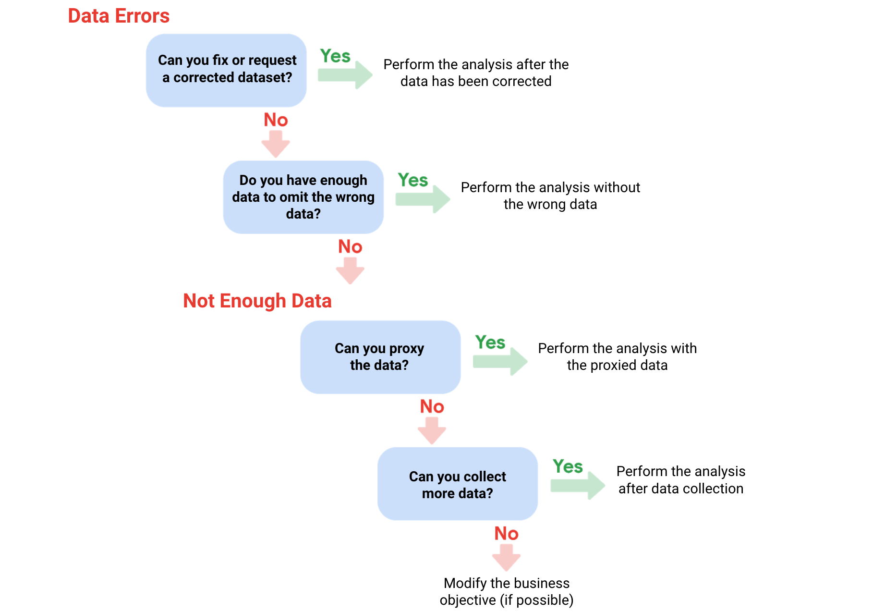

# Superar los retos de la insuficiencia de datos

## Tratar con datos insuficientes
- ​Todos los analistas se han encontrado en una situación en la que no hay datos suficientes para alcanzar ​su objetivo empresarial.
- ​Teniendo en cuenta la cantidad de datos que se generan todos los días, puede resultar difícil de creer, pero ​es cierto.
- ​Así que analicemos lo que puede hacer cuando no tiene datos suficientes.
- ​Explicaremos cómo establecer límites para el alcance de su análisis y ​qué datos debe incluir.
- ​En un momento dado, fui analista de datos en un centro de soporte.
- ​Todos los días recibíamos preguntas de los clientes, que se registraban como tickets de soporte.
- ​Me pidieron que previera la cantidad de tickets de soporte que llegarían por ​mes para saber cuántas personas adicionales necesitábamos contratar.

- ​Era muy importante que tuviéramos datos suficientes que abarcaran al menos ​un par de años, porque tenía que tener en cuenta los cambios estacionales y de un año a otro.
- ​Si hubiera tenido disponibles los datos del año en curso, ​no habría sabido que es común que se produzca un repunte en enero y que ​tiene que ver con que las personas solicitan reembolsos después de las fiestas.
- ​Como tenía datos suficientes, ​pude sugerir que contratáramos a más personas en enero para prepararnos.
- Es ​probable que surjan desafíos, ​pero la buena noticia es que, una vez que conozca su objetivo empresarial, ​podrá reconocer si tiene suficientes datos.
- ​Y si no lo hace, podrá resolverlo antes de comenzar el análisis.
- ​Ahora, veamos algunas de las limitaciones con las que te puedes encontrar y ​cómo puedes gestionar diferentes tipos de datos insuficientes.
- ​Supongamos que trabajas en la industria del turismo y ​necesitas averiguar qué planes de viaje se buscan con más frecuencia.

- ​Si solo utilizas los datos de un sitio de reservas, ​te estás limitando a los datos de una sola fuente.
- ​Es posible que otros sitios de reservas muestren tendencias diferentes que quieras tener en cuenta para ​tu análisis.
- ​Si una limitación como esta afecta a su análisis, puede detenerse y ​volver a hablar con su parte interesada para elaborar un plan.
- ​Si el conjunto de datos sigue actualizándose, significa que los datos siguen llegando y es ​posible que no estén completos.
- ​Por lo tanto, si hay una atracción turística nueva ​para la que estás analizando el interés y la asistencia, es probable que no haya datos suficientes para determinar las tendencias.
- ​Por ejemplo, es posible que desee esperar un mes para recopilar los datos.
- ​O puede ponerse en contacto con la parte interesada y preguntar sobre cómo ajustar el objetivo.

- ​Por ejemplo, puede analizar las tendencias de una semana a otra en lugar de de un mes a otro.
- ​También puedes basar tu análisis en las tendencias de los últimos tres meses y decir: ​«Así es como podría ser la asistencia a la atracción durante el cuarto mes».
- ​Es posible que no tenga datos suficientes para saber si este número es demasiado bajo o demasiado alto.
- ​Sin embargo, le dirías a la parte interesada que es tu mejor estimación en función de los datos de los que ​dispones actualmente.
- ​Por otro lado, sus datos podrían ser más antiguos y dejar de ser relevantes.
- ​Datos desactualizados sobre la satisfacción del cliente no incluirán las respuestas más recientes.
- ​Por lo tanto, confiará en las calificaciones de los hoteles o ​alquileres vacacionales que tal vez ya no sean precisas.

- ​En este caso, lo mejor que puede hacer es encontrar un nuevo conjunto de datos con el que trabajar.
- ​Datos que están limitados geográficamente también pueden no ser confiables.
- ​Si su empresa es global, no querrá usar datos limitados para viajar a ​un solo país.
- Querría un conjunto de datos que incluya todos los países.
- ​Estas son solo algunas de las limitaciones más comunes con las que te encontrarás y ​algunas formas de abordarlas.
- ​Puede identificar tendencias con los datos disponibles o esperar a recibir más datos si el tiempo lo permite; ​puede hablar con la parte interesada y ajustar su objetivo; o puede buscar ​un nuevo conjunto de datos.
- ​La necesidad de tomar estas medidas dependerá de su función en la empresa y, ​posiblemente, de las necesidades de la industria en general.

- ​Sin embargo, aprender a gestionar datos insuficientes siempre es una buena manera de ​prepararse para el éxito.
- ​Sus poderes de analista de datos son cada vez más fuertes.
- Y justo a tiempo.
- ​Después de obtener más información sobre las limitaciones y las soluciones, ​aprenderá sobre el poder estadístico, otra herramienta fantástica que puede utilizar.
- ​¡Nos vemos pronto! 

---

## Cuando encuentre un Problema con sus Datos
- Cuando se esté preparando para el análisis de datos, puede que se dé cuenta de que no tiene los datos que necesita o de que no tiene suficientes.
- En algunos casos, puede utilizar lo que se conoce como datos proxy en lugar de los datos reales.
- Piense en ello como sustituir la mantequilla por aceite en una receta cuando no tiene mantequilla.
- En otros casos, no hay sustituto razonable y su única opción es recopilar más datos.
- Considere los siguientes Problemas de datos y sugerencias sobre cómo solucionarlos.

- Problema de datos 1: no hay datos

| Posibles soluciones   | Ejemplos de soluciones en la vida real |
| --------------------- | -------------------------------------- |
| Reúna los datos a pequeña escala para realizar un análisis preliminar y, a continuación, solicite tiempo adicional para completar el análisis una vez que haya recopilado más datos.  | Si está encuestando a los empleados sobre lo que piensan de un nuevo plan de rendimiento y bonificaciones, utilice una muestra para realizar un análisis preliminar. Después, pida otras 3 semanas para recoger los datos de todos los empleados. |
| Si no hay tiempo para recoger los datos, realice el análisis utilizando datos proxy de otros conjuntos de datos. Esta es la solución más habitual. | Si está analizando las horas punta de los desplazamientos de los trabajadores pero no dispone de los datos de una ciudad concreta, utilice los datos de otra ciudad con un tamaño y una demografía similares. |

- Problema de datos 2: muy pocos datos

| Posibles soluciones   | Ejemplos de soluciones en la vida real |
| --------------------- | -------------------------------------- |
| Haga el análisis utilizando datos proxy junto con los datos reales. | Si está analizando las tendencias de los propietarios de golden retrievers, amplíe su conjunto de datos incluyendo los datos de los propietarios de labradores. |
| Ajuste su análisis para alinearlo con los datos que ya tiene. | Si le faltan datos de personas de 18 a 24 años, haga el análisis pero anote la siguiente limitación en su informe: esta conclusión se aplica sólo a los adultos de 25 años o más. |

- Problema 3: Datos erróneos, incluidos datos con errores*

| Posibles soluciones   | Ejemplos de soluciones en la vida real |
| --------------------- | -------------------------------------- |
| Si tiene datos erróneos porque se malinterpretaron los Requisitos, vuelva a comunicarlos. | Si necesita los datos de las votantes femeninas y ha recibido los de los votantes masculinos, vuelva a exponer sus necesidades. |
| Identifique los errores en los Datos y, si es posible, corríjalos en su origen buscando un Patrón en los errores. | Si sus datos están en una hoja de cálculo y hay una sentencia condicional o una booleana que hace que los cálculos sean erróneos, cambie la sentencia condicional en lugar de limitarse a corregir los valores calculados. |
| Si no puede corregir los datos erróneos usted mismo, puede ignorar los datos erróneos y seguir adelante con el análisis si el tamaño de su muestra sigue siendo lo suficientemente grande y el hecho de ignorar los datos no causará un sesgo sistemático.  | Si su conjunto de datos fue traducido de un idioma diferente y algunas de las traducciones no tienen sentido, ignore los datos con mala traducción y siga  |

   - * Nota importante: A veces, los Datos con errores pueden ser una señal de advertencia de que los datos no son fiables. Utilice su mejor criterio.

- Utilice el siguiente Árbol de decisiones como recordatorio de cómo tratar los errores en los Datos o la insuficiencia de los mismos:

---

## La importancia del tamaño de la Muestra
- Vale, antes hemos hablado de tener ​el tipo de datos adecuado para cumplir su objetivo empresarial ​y de la importancia de contar con la cantidad de datos adecuada para ​asegurarse de que su análisis es lo más preciso posible.
- ​Puede que recuerde que para los analistas de datos, ​una población son todos los valores de datos posibles ​en un determinado conjunto de datos.
- ​Si es capaz de utilizar el 100% de ​una población en su análisis, estupendo.
- ​Pero a veces recopilar información sobre ​una población entera simplemente no es posible.
- ​Lleva demasiado tiempo o es demasiado caro.
- ​Por ejemplo, digamos que una organización mundial ​desea saber más sobre los propietarios de mascotas que tienen gatos.
- ​Su tarea es averiguar qué tipos de ​juguetes prefieren los dueños de gatos en Canadá.

- ​Pero hay millones de dueños de gatos en Canadá, ​así que obtener datos de todos ellos ​sería un enorme desafío.
- ​¡No tema! Permítame presentarle.
- ¡el tamaño de la muestra! ​Cuando se utiliza el tamaño de la muestra o una muestra, ​se utiliza una parte de una población ​que sea representativa de la población.
- ​El objetivo es obtener suficiente información ​de un pequeño grupo dentro de ​una población para hacer predicciones ​o conclusiones sobre toda la población.
- ​El tamaño de la muestra ayuda a ​asegurar el grado en que puede estar ​seguro de que sus conclusiones ​representan con exactitud a la población.
- ​Para los datos sobre propietarios de gatos, ​el tamaño de la muestra podría contener datos sobre ​cientos o miles de personas en lugar de millones.

- ​Utilizar una muestra para el análisis es más ​económico y lleva menos tiempo.
- ​Si se hace con cuidado y reflexión, ​se pueden obtener los mismos resultados utilizando ​una muestra de tamaño en lugar de intentar cazar ​a todos y cada uno de los propietarios de gatos ​para averiguar cuáles son sus juguetes favoritos para gatos.
- ​Sin embargo, existe un posible inconveniente.
- ​Cuando sólo se utiliza una pequeña muestra de una Población, ​puede generar incertidumbre.
- ​Realmente no puede estar seguro al 100% ​de que sus estadísticas sean ​una representación completa y exacta de la población.
- ​Esto conlleva un sesgo en el muestreo, ​del que ya hemos hablado anteriormente en el Programa.
- ​Se habla de sesgo en el muestreo cuando una muestra ​no es representativa de la población en su conjunto.

- ​Esto significa que algunos miembros de la población están ​sobrerrepresentados o infrarrepresentados.
- ​Por ejemplo, si la Encuesta utilizada para recoger datos de ​propietarios de gatos sólo incluyera a personas con smartphones, ​entonces los propietarios de gatos que no tienen ​un smartphone no estarían representados en los datos.
- ​Utilizar el Muestreo aleatorio puede ayudar ​a resolver algunos de esos problemas con el sesgo del muestreo.
- ​El muestreo aleatorio es una forma de ​seleccionar una muestra de una población de modo ​que todos los tipos posibles de ​la muestra tengan las mismas posibilidades de ser elegidos.
- ​Volviendo de nuevo a nuestros propietarios de gatos, ​utilizar una muestra aleatoria de propietarios de gatos significa que los propietarios de gatos ​de todos los tipos tienen las mismas posibilidades de ser elegidos.
- ​Los propietarios de gatos que viven en apartamentos en Ontario tendrían ​las mismas posibilidades de estar representados que ​los que viven en casas en Alberta.
- ​Como analista de datos, ​se dará cuenta de que la creación de tamaños de muestra normalmente ​tiene lugar antes incluso de llegar a los datos.

- ​Pero aún así es bueno que sepa que ​los datos que va a analizar son ​representativos de la población ​y funcionan con su objetivo.
- ​También es bueno que sepa lo que ​le espera en su viaje por los datos.
- ​En el próximo vídeo, tendrá una opción para sentirse aún ​más cómodo con los tamaños de las muestras.
- Nos vemos allí.

---

## Calcular el tamaño de la Muestra
- Antes de profundizar en el tamaño de la muestra, familiarícese con estos términos y definiciones:

| Terminología | Definiciones |
| ------------ | ------------ |
| Población    | Todo el grupo que le interesa para su estudio. Por ejemplo, si está encuestando a personas de su empresa, la población serían todos los empleados de su empresa. |
| Muestra      | Un subconjunto de la población. Al igual que una muestra de alimentos, se llama muestra porque es sólo una muestra. Por lo tanto, si su empresa es demasiado grande para encuestar a todos los individuos, puede encuestar a una muestra representativa de su población. |
| Margen de error | Dado que una muestra se utiliza para representar a una población, se espera que los resultados de la muestra difieran de los que se habrían obtenido si se hubiera encuestado a toda la población. Esta diferencia se denomina Margen de error. Cuanto menor sea el margen de error, más se acercarán los resultados de la muestra a los que se habrían obtenido si se hubiera encuestado a toda la población. |
| Nivel de confianza | Grado de confianza en los resultados de la encuesta. Por ejemplo, un Nivel de confianza del 95% significa que si realizara la misma encuesta 100 veces, obtendría resultados similares 95 de esas 100 veces. El Nivel de confianza se determina antes de iniciar el estudio porque influirá en el margen de error al final del estudio. |
| Intervalo de confianza | El intervalo de posibles valores que tendría el resultado de la población en el nivel de confianza del estudio. Este intervalo es el resultado de la muestra +/- el margen de error. |
| Significación estadística | La determinación de si el resultado podría deberse al azar o no. Cuanto mayor es la significación, menos se debe al azar. |

- Aspectos a tener en cuenta al determinar el tamaño de la muestra
   - A la hora de calcular el tamaño de la muestra, tenga en cuenta lo siguiente:
      - No utilice un tamaño de muestra inferior a 30.
         - Se ha demostrado estadísticamente que 30 es el tamaño de muestra más pequeño en el que el resultado medio de una muestra empieza a representar el resultado medio de una población.
      - El nivel de confianza más utilizado es el 95%, pero el 90% puede funcionar en algunos casos.
   - Aumente el tamaño de la muestra para satisfacer las necesidades específicas de su proyecto:
      - Para un mayor Nivel de confianza, utilice un tamaño de muestra mayor
      - Para disminuir el margen de error, utilice un tamaño de muestra mayor
      - Para una mayor significación estadística, utilice un tamaño de muestra mayor
   - Nota: Las calculadoras del tamaño de la muestra utilizan fórmulas estadísticas para determinar el tamaño de la muestra. Más información al respecto en el curso  Esté atento.

- ¿Por qué una muestra mínima de 30?
   - Esta recomendación se basa en el Teorema del límite central (CLT) en el campo de la probabilidad y la estadística.
   - A medida que aumenta el tamaño de la muestra, los resultados se parecen más a la distribución normal (en forma de campana) de un gran número de muestras.
   - Una muestra de 30 es el tamaño de muestra más pequeño para el que el CLT sigue siendo válido.
   - Los investigadores que se basan en el análisis de regresión - métodos estadísticos para determinar las relaciones entre variables controladas y dependientes - también prefieren una muestra mínima de 30.
   - ¿Sigue teniendo curiosidad? Sin entrar demasiado en las matemáticas, eche un vistazo a estos artículos: 
      - [Teorema del límite central (CLT)](https://www.investopedia.com/terms/c/central_limit_theorem.asp): Este artículo de Investopedia explica el Teorema del límite central y describe brevemente cómo puede aplicarse al análisis de un índice bursátil. 
      - [Fórmula del tamaño de la muestra](https://www.statisticssolutions.com/dissertation-resources/sample-size-calculation-and-sample-size-justification/sample-size-formula/): Este artículo de Statistics Solutions proporciona un poco más de detalle sobre por qué algunos investigadores utilizan 30 como tamaño mínimo de la muestra.

- Los tamaños de muestra varían según el problema empresarial
   - El tamaño de la muestra variará en función del tipo de problema empresarial que intente resolver.
   - Por ejemplo, si vive en una ciudad con una población de 200.000 habitantes y consigue que 180.000 personas respondan a una encuesta, se trata de una muestra de gran tamaño.
   - Pero sin hacer eso, ¿cómo sería un tamaño de muestra aceptable y más pequeño?
   - ¿Estarían bien 200 si las personas encuestadas representaran a todos los distritos de la ciudad? 
   - Respuesta: Depende de lo que esté en juego.
      - Una muestra de 200 personas puede ser suficiente si el problema consiste en saber qué opinan los vecinos de la nueva biblioteca
      - Una muestra de 200 personas podría no ser suficiente si el problema consiste en determinar cómo votarían los residentes para financiar la biblioteca
   - Probablemente acepte un mayor margen de error si la encuesta se centra en la opinión de los residentes sobre la nueva biblioteca que si se centra en cómo votarían para financiarla.
   - Por ese motivo, lo más probable es que utilice una muestra más grande para la encuesta a los votantes.

- Las muestras de mayor tamaño tienen un coste más elevado
   - También hay que sopesar el coste frente a las ventajas de obtener resultados más precisos con una muestra de mayor tamaño.
   - Alguien que intenta comprender las preferencias de los consumidores por una nueva línea de productos no necesitaría un tamaño de muestra tan grande como alguien que intenta comprender los efectos de un nuevo medicamento.
   - En el caso de la seguridad de los fármacos, las ventajas superan el coste de utilizar una muestra de mayor tamaño.
   - Pero en el caso de las preferencias de los consumidores, una muestra más pequeña con un coste menor podría proporcionar resultados suficientemente buenos.

- Saber lo básico es útil
   - Conocer los aspectos básicos le ayudará a tomar las decisiones correctas en lo que respecta al tamaño de la muestra.
   - Siempre puede plantear sus dudas si se encuentra con un tamaño de muestra demasiado pequeño.
   - Una calculadora del tamaño de la muestra también es una gran herramienta para ello.
   - Las calculadoras del tamaño de la muestra le permiten introducir un nivel de confianza y un margen de error deseados para un tamaño de población determinado.
   - A continuación, calculan el tamaño de muestra necesario para alcanzar estadísticamente esos resultados.
   - Consulte el vídeo Determinar el mejor tamaño de la muestra para ver una demostración de una calculadora del tamaño de la muestra, o consulte la lectura Calculadora del tamaño de la muestra para obtener información adicional. 

- Puntos clave
   - A medida que avance en el análisis de datos, asegúrese de familiarizarse con los términos clave, como población, muestra, margen de error, nivel de confianza e intervalo de confianza, antes de calcular el tamaño de la muestra.
   - Recuerde que se recomienda un tamaño de muestra mínimo de 30 y que el tamaño de la muestra varía en función del problema empresarial específico.
   - A la hora de determinar el tamaño de la muestra, tenga también en cuenta la relación entre precisión y coste, ya que las muestras más grandes proporcionan resultados más precisos, pero a un coste más elevado.
   - Por último, utilice calculadoras de tamaño de muestra para determinar el tamaño de muestra adecuado para su estudio.

---

## Autorreflexión: Actividades previas a la limpiez
- Resumen de la actividad
   - Ahora que ya sabe cómo prepararse para la limpieza de datos, puede detenerse un momento y reflexionar sobre estos pasos.
   - En esta autorreflexión, considerará sus ideas sobre la importancia de las actividades previas a la limpieza y responderá a unas breves preguntas.
   - Esta autorreflexión le ayudará a desarrollar ideas sobre su propio aprendizaje y le preparará para aplicar sus conocimientos sobre las actividades previas a la limpieza y los datos insuficientes a su propio trabajo de limpieza de datos.
   - A medida que responda a las preguntas -y formule las suyas propias- tendrá en cuenta conceptos, prácticas y principios que le ayudarán a refinar su comprensión y a reforzar su aprendizaje.
   - Usted ha hecho el trabajo duro, así que asegúrese de sacarle el máximo partido: ¡Esta reflexión le ayudará a que sus conocimientos se queden grabados!

- Instrucciones paso a paso

1. Revisar la integridad de los datos
   - Antes de que los analistas de datos puedan analizar los datos, primero tienen que pensar y comprender los datos con los que están trabajando.
   - Evaluar la integridad de los datos es un paso clave en este proceso.
   - Como ha aprendido en lecciones anteriores, debe completar las siguientes tareas antes de analizar los datos:
      1. Determine la integridad de los datos evaluando su exactitud, coherencia e integridad generales.
      2. Conecte los objetivos a los datos comprendiendo cómo pueden servir a sus objetivos empresariales una investigación de los datos.
      3. Sepa cuándo debe dejar de recopilar datos.
   - Los analistas de datos realizan actividades de prelimpieza para completar estos pasos.
   - Las actividades de limpieza previa le ayudan a determinar y mantener la integridad de los datos, lo que es esencial para el papel de un analista de datos junior.

2. Identificar qué hace que los datos sean insuficientes
   - Uno de los objetivos de las actividades de depuración previa es abordar la insuficiencia de datos. 
   - FROM previous lessons that data can be insufficient for a number of reasons.
   - Los Datos insuficientes presentan uno o más de los siguientes problemas:
      - Proceden de una sola fuente
      - Se actualizan continuamente y están incompletos
      - Está anticuado
      - Está limitado geográficamente

3. Tratar los datos insuficientes
   - Para hacer frente a la insuficiencia de datos, puede:
      - Identificar tendencias dentro de los Datos disponibles.
      - Esperar a disponer de más datos si el tiempo lo permite.
      - Discutirlo con las partes interesadas y ajustar su objetivo.
      - Buscar un nuevo Conjunto de datos.

- Reflexión

1. Considere lo que ha aprendido sobre la insuficiencia de datos y los pasos para evitarla:
   - ¿Por qué es importante completar los pasos previos a la limpieza de datos?
   - ¿Qué problemas podrían surgir si no sigue estos pasos?
   - Ahora, escriba 2-3 frases (40-60 palabras) en respuesta a cada una de estas preguntas.

- Respuestas
- ¿Por qué es importante completar los pasos previos a la limpieza de datos?
Es importante completar los pasos previos a la limpieza de datos porque permiten evaluar la integridad de los datos, asegurando que sean precisos, consistentes y completos. Esto garantiza que el análisis posterior sea confiable y relevante para los objetivos empresariales, evitando conclusiones erróneas basadas en datos insuficientes o incorrectos.
- ¿Qué problemas podrían surgir si no sigue estos pasos?
Si no se siguen los pasos previos a la limpieza de datos, podrían surgir problemas como análisis inexactos, conclusiones erróneas y decisiones empresariales mal fundamentadas. La falta de evaluación de la integridad de los datos puede llevar a utilizar información incompleta o incorrecta, lo que compromete la validez del análisis y afecta negativamente a los resultados y estrategias empresariales.

> ¡Gran trabajo reforzando su aprendizaje con una autorreflexión reflexiva! Una buena reflexión sobre este tema incluiría cómo las actividades de limpieza previa son importantes porque aumentan la eficacia y el éxito de sus tareas de análisis de datos.
> Si sabe que sus datos son precisos, coherentes y completos, puede confiar en que sus resultados serán válidos. Las partes Interesadas estarán satisfechas si usted conecta los Datos con los objetivos del negocio. Y, saber cuándo dejar de recopilar datos le permitirá terminar sus tareas a tiempo sin sacrificar la integridad de los datos.
> Supongamos que no ha determinado la integridad de los datos. Puede encontrarse con que está trabajando con datos inexactos o que faltan, lo que puede provocar resultados engañosos en sus análisis. Si no relaciona los objetivos con los datos, es posible que su análisis no sea relevante para las partes interesadas. Por último, no saber cuándo dejar de recopilar datos puede provocar retrasos innecesarios en la finalización de las tareas. Si completa las actividades previas a la limpieza, evitará estos problemas.